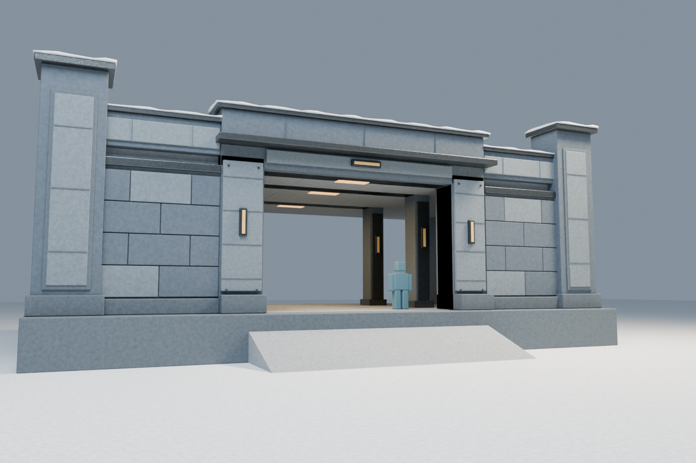

# Snow Fortress — Blender entrance kit v1

Status: modeled, UV-unwrapped, textured, exported and rendered in Blender 4.3.2. **Not imported into Roblox or installed in Convergence.** This package is the first architectural quality slice, not the whole fortress, a new HUD, or a performance-approved production build.

## Review

Open `SnowFortress_EntranceKit_v1.blend` alongside its `textures` folder. The initial camera shows the approach. Named module collections contain editable components; `EXPORTS / local origins` contains the joined, single-material meshes. Both are hidden in the review scene; enable one collection at a time to edit it. The review collection contains instances of the actual baked export meshes, not a separate high-poly facade.



The kit introduces deep jambs, ashlar stone courses, substantial piers, layered coping, shaped snow surfaces and sheltered interior supports. It is a stylized alpine military treatment. The tall tiered keep, outposts, scenery and HUD are future slices; this entrance does not satisfy those requirements by itself.

## Modules

| Module | Purpose | Triangles |
| --- | --- | ---: |
| SF_Portal_20 | 20-stud-wide, 13-stud-high clear opening; framed entry and upper crest | 3,252 |
| SF_WallBay_10 | 10-stud repeatable stone wall bay | 1,404 |
| SF_Pier_21 | Raised structural pier, recessed face, cap and snow | 828 |
| SF_Parapet_10 | 10-stud upper wall and coping | 624 |
| SF_InteriorBay_20 | Paired columns and ceiling beam around 20-stud clear space | 1,188 |
| SF_Floor_10 | 10 × 10-stud slab with inset corner details | 540 |
| SF_Cover_8 | 8-stud cover core, steel edges and snow treatment | 756 |
| **Unique kit total** | Instancing increases scene triangle/draw counts | **8,592** |

Every module has one UV set, one material, one mesh, and four 1024px textures: Color, tangent-space OpenGL Normal, Roughness and Metalness. FBX and GLB exports embed their texture dependencies. The source PNGs are provided for explicit SurfaceAppearance assignment if needed. The lamp lenses carry their amber base color; local lights/emission in the Blender stage are not imported gameplay lights.

The 1024px maps are master-quality exports. Seven sets of four RGBA texture maps at this size would occupy 112 MiB before compression/mipmaps; this is an upper-bound planning calculation, not measured Roblox memory use. Downsize smaller floor/cover/parapet maps to 512px and measure visual quality and memory before broad mobile deployment. No manually authored LOD meshes are included in this first kit.

## Studio import and review

### Fast path: one-file walking test

`exports/SnowFortress_ReviewSlice.glb` contains the assembled entrance, adjoining interior, foundation, ramp and bounded snow floor. Its geometry and textures are embedded. This is an isolated review slice, not a replacement Convergence map.

1. Open a new Baseplate place in Studio and remove its default SpawnLocation.
2. Import `SnowFortress_ReviewSlice.glb` as one Model with Scale Unit **Stud** and Y-up / Top. Keep the supplied orientation.
3. Select that imported Model. Paste the contents of `setup_imported_slice.luau` into Studio's Command Bar in edit mode and run it. It anchors the visual meshes and supplies authored collision boxes, interior lights and a test spawn. It checks the test-floor scale before making changes.
4. Press Play to walk through the entrance. This setup script is syntax/lint checked, but has not been run in Studio; inspect its output and verify material import before judging rendering parity.

The bundle is generated by `tools/blender/export_fortress_review_slice.py`. The kit's previous individual-module workflow follows for reuse in the actual map.

### Individual modules and runtime integration

1. Use a local review place or edit-mode copy of the game. Import the **seven GLB files** from `exports`. Import each as a Model; use **Scale Unit: Stud**, Y-up / Top. Retain the supplied orientation and do not rescale manually. Use the creator/group that owns the game when uploading. FBX alternatives are also provided, but the assembly helper assumes the GLB orientation.
2. Put the imported Models in a Folder named `SnowFortressKitImports` under Workspace. Name each Model exactly as its filename without `.glb`.
3. Inspect material import. A MeshPart should have its texture maps carried by SurfaceAppearance. If a channel did not import, upload its corresponding PNG and assign ColorMap, NormalMap, RoughnessMap or MetalnessMap. Do not use Blender shader nodes as evidence that Roblox has the same material.
4. Run the supplied `assemble_review.luau` in Studio's Command Bar **in edit mode**. It checks module dimensions before changing anything, then creates `SnowFortressBlenderReview` at Y=1000. It leaves the imported templates and live map untouched. This helper has been syntax-checked but has not been executed in Studio.
5. The helper assembles the mesh modules and simple invisible collision boxes. Blender's temporary ground, foundation, ramp, mannequin and lighting are review staging and are not included by the helper. Focus the selected review model to inspect it. Add a test floor if walking the isolated slice.
6. Verify material channels, entrance clearance, scale next to a normal avatar, seams, collision, and bullet behavior. Reproduce ordinary map lighting and check a target phone before approving the kit for placement.

Official setup guidance: [Blender and Studio units/export settings](https://create.roblox.com/docs/art/blender), [mesh specifications](https://create.roblox.com/docs/art/modeling/specifications), [texture and SurfaceAppearance specifications](https://create.roblox.com/docs/art/modeling/texture-specifications). Reviewed 2026-09-20.

## Placement contract

One Blender unit is one stud. Blender local X runs across the facade, +Y runs inward, and +Z runs up. Module origins sit at the center of their footprint at the base. Floor origin is the walking surface. GLB Y-up mapping is `(x,y,z) -> (x,z,-y)`.

The live west entrance's nominal center is Roblox `(-70,4,0)`, with 20 studs between jambs and 13 studs to the underside of the upper slab. To face inward toward +X, an imported GLB-local assembly would use `CFrame.new(-70,4,0) * CFrame.Angles(0,-math.pi/2,0)`. Verify orientation using an asymmetric lamp/reveal before applying this transform to a group.

**Do not stamp the review assembly over the live map.** Its taller piers, parapets, deeper jambs and side returns are new structural geometry. The review's side walls would intersect existing launch approaches if installed indiscriminately. Preserve the four launch corridors, both stair slots, zip landings, full upper floor and upstairs objective volume during integration. Keep only compatible modules at approved placements; replace the corresponding graybox solids instead of layering conflicting collision on top.

`manifest.json` records exact bounds, collision boxes, textures and triangle counts. Collision boxes represent major structural masses; small bevels, inset seams and snow are cosmetic. Render meshes must not silently imply large areas of cover that collision omits. Review projectile behavior at cornices and snow edges during Studio acceptance.

After the in-engine slice is approved, save the imported Models into the project's asset hierarchy and add a runtime template-cloning path with authored placement transforms. There are no invented asset IDs or enabled runtime references in this package.

## Rebuild and verification

From the repository root, using PowerShell:

```powershell
& 'C:/Program Files/Blender Foundation/Blender 4.3/blender.exe' --factory-startup --background --python-exit-code 1 --python tools/blender/build_fortress_kit.py
& 'C:/Program Files/Blender Foundation/Blender 4.3/blender.exe' --factory-startup --background --python-exit-code 1 --python tools/blender/verify_fortress_kit.py
python tools/blender/prepare_fortress_import.py
```

To rerender after a lighting/camera/staging adjustment without rebaking exports:

```powershell
& 'C:/Program Files/Blender Foundation/Blender 4.3/blender.exe' --factory-startup --background --python-exit-code 1 --python tools/blender/render_fortress_review.py
```

`verification.json` records FBX/GLB reimport bounds, triangle counts, UV range and open-edge checks for all seven modules; texture dimensions and the portal's collision opening are also checked. Coincident edges between assembled closed components are recorded separately from holes. These checks do not establish Studio import correctness, live gameplay balance, rendering parity, or phone performance.
