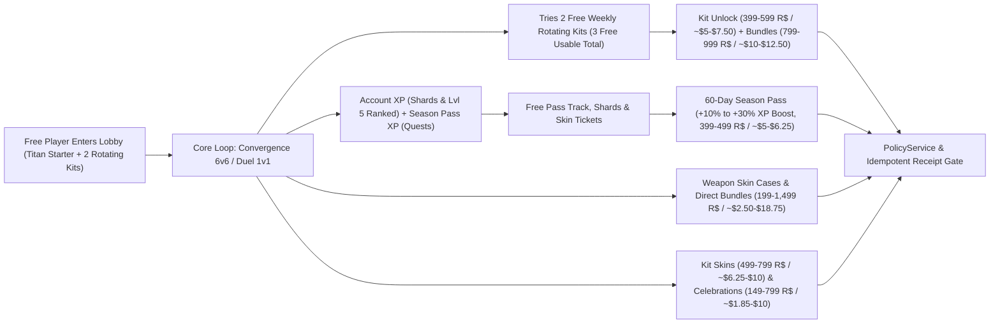

# 2-Year Business Plan: ENGAGE / *Convergence* (Roblox Arena Shooter)

> [!IMPORTANT]
> **Executive Thesis:** *ENGAGE* (*Convergence: The Dark Matter Saga*) already has a playable, CI-validated technical foundation (Rojo + Wally + Knit + ProfileStore, 13 weapons, scaffolding placeholder data for 42 weapon skins and 8 celebrations, 17 map modules, cross-platform Touch UI, and an AI + Blender 3D asset pipeline). Because Roblox absorbs multiplayer server hosting, matchmaking, auth, and payment processing, **baseline cash buffer needed is ~\$12,000–\$22,000**—or **~\$15,000–\$25,000 fully loaded** once LLC/IP-assignment legal fees, commercial SFX/audio packs, QA playtest stipends, Day-1 cosmetic polish, and DevEx payout lag are included. **0% of in-game monetization is wired in code today**, `Stats.XP` / `Stats.Level` currently unlock nothing, and our baseline financial scenarios intentionally rely on **only 2 of Roblox's 8 active revenue streams** (IAP + Daily Engagement Creator Rewards), leaving **6 high-margin streams** (100%-renewal Subscriptions, Rewarded Video Ads, In-Experience 40%/70% Avatar UGC, Private Servers, Audience Expansion, and Immersive Ads) as unmodeled upside.

---

## 1. Current Asset & Technical Audit (Where We Start on Day 1)

Unlike a greenfield concept, this project enters Month 1 with substantial engineering and content already built in [README.md](../../README.md) and [CLAUDE.md](../../CLAUDE.md):

| Domain | Verified Current State in Repository | Business Impact |
| :--- | :--- | :--- |
| **Core Gameplay Loop** | **Convergence** (objective 3→2→1 zone collapse), **Duel** (1v1/2v2), **TDM**, and **Solo Training** with AI bots (`BotService.lua`). | Supports both competitive 1v1 retention (like *Rivals*) and deeper team objective play. |
| **Weapons & Movement** | 13 weapons in [Weapons/init.lua](../../src/shared/Weapons/init.lua) (7 Primary, 6 Secondary/Melee/Utility incl. Katana & Jetpack + `WhiteSniper` pickup) + Rivals-style sprint/crouch/slide. | Eliminates \$15k–\$30k in initial FPS core framework scripting costs. |
| **Cosmetics & Lore** | Architectural scaffolding only (**42 weapon skin configs**, **8 celebration configs**, **2 character skins**, **17 map modules**, 5 `.glb` kit concepts) + [DARK_MATTER_LORE_BIBLE.md](../design/lore/DARK_MATTER_LORE_BIBLE.md). | Current cosmetics are **early placeholders**; code schemas reduce wiring time, but **Day-1 ship-quality skins, kit meshes & VFX must still be produced** before launch. |
| **Kits / Alter Egos** | `Titan -> Colossus` v1 live in [AlterEgos.lua](../../src/shared/AlterEgos.lua); sidegrade Kit architecture & UI specced in [KIT_MINIMUM_CHECKLIST.md](../design/kits/KIT_MINIMUM_CHECKLIST.md) and [KIT_SELECTION_UI_SPEC.md](../design/kits/KIT_SELECTION_UI_SPEC.md). | Locked **non-P2W pillar**: **1 Permanent Starter (`Titan`) + 2 Weekly Trial Rotations (3 free usable Kits)** + Shard/Robux unlocks & Robux-only Kit Skins. |
| **XP & Progression** | [StatsService.lua](../../src/server/Services/StatsService.lua) + [Progression.lua](../../src/shared/Progression.lua) compute match XP and persist `Stats.XP` / `Stats.Level` in [DataService.lua](../../src/server/Services/DataService.lua) (`RecapController.lua` displays it). | **Currently cosmetic/display-only** (unlocks nothing). **M1–M2 task:** split into Account Level rewards + 60-day Season Pass XP track. |
| **Cross-Platform UI** | `TouchController` + `Screen.lua` + `Theme.lua` built; small-phone overlap & multi-client QA pending ([PROFESSIONALISM_PASS.md](../design/lobby-experience/PROFESSIONALISM_PASS.md)). | Critical for Roblox, where mobile/tablet drive >60% of session volume. |
| **Monetization Code** | **Not yet implemented** (`MarketplaceService`, GamePasses, Developer Products, receipts, and `PolicyService` compliance absent from `src/`). | **Month 1–2 P0 Gate:** Must build idempotent receipt handling & shop UI before any paid ads. |

---

## 2. Competitive Benchmarks: Popular Roblox Games & Real Cost Structures

To ground this plan in reality rather than guesswork, we benchmarked top Roblox FPS and competitive live-ops titles across development cost, team size, monetization mechanics, and acquisition spend:

| Title (Studio) | Scale & CCU Profile | Core Team & Dev Cost Benchmark | Monetization Engine | Growth & Marketing Driver |
| :--- | :--- | :--- | :--- | :--- |
| **RIVALS** *(Nosniy Games)* | Category leader: 19B+ visits, 100k–450k+ daily CCU, ~967k peak CCU (Feb 2026). | **~3 core devs** + specialist contractors (3D/UI, anims, maps, audio). Minimal upfront cash (sweat equity from veteran creators). | **Cosmetic-first:** Skin Cases (249 R\$ [~\$3.11 retail / \$0.66 net] single; 724 R\$ [~\$9.05 retail / \$1.93 net] 3-pack), Key Bundles (49 R\$+ [~\$0.61+ / \$0.13+ net]), Theme Bundles, Daily Shop, Season Pass, Skin Trading. | Launched quietly (~20 CCU) → exploded via ultra-crisp 1v1 loop, TikTok/YouTube Shorts clipability, and Roblox Home algorithm. |
| **Arsenal** *(ROLVe)* | Legacy arcade king: >150k historical peak CCU; cooled to low-thousands CCU by 2025–2026. | **5–10 core devs** + seasonal contractors. Mid-high tier build (**\$50k–\$150k+** cumulative investment). | BattleBucks crates, character skins, melee variants, announcer packs, kill effects, group XP/currency bonus (+25%). | Legacy creator brand + frequent seasonal event drops. Shows risk of failing to modernize movement/UI vs. *Rivals*. |
| **Phantom Forces** *(StyLiS)* | Long-tail tactical FPS staple. | **3–6 core devs** + community mods/web infra. | Weapon skin cases/keys, blueprint unlocks, rank/credit bundles. | Deep gunsmith progression + loyal PC/console core audience. |
| **Gunfight Arena** *(Gunfight Studio)* | 1B+ visits; thousands to tens of thousands CCU around updates. | Mid-sized contractor/studio pod (**\$20k–\$50k+** initial build). | Camo crates, attachment/weapon skips, prestige/credit multipliers, friend-boost passes (draws P2W criticism). | Weekly update cadence + YouTube/Shorts montage creators. |
| **Frontlines** *(VASE / Maniac)* | High-fidelity visual showcase FPS. | **5–10 devs/contractors** over multi-year cycle (**\$200k–\$500k+**). | Battle pass, premium skins, bundles. | Proves diminishing ROI of hyper-realistic PBR graphics on Roblox vs. stylized readability & 60fps mobile performance (*Rivals* wins on mobile). |
| **BedWars** *(Easy.Games)* & **Blade Ball** | Multi-million-dollar/yr live-ops engines; *Blade Ball* hit 545k+ peak CCU. | *BedWars*: **\$100k+** full studio payroll. *Blade Ball*: **<\$10k MVP** by 2 devs, then scaled to heavy live-ops/creator spend. | *BedWars*: **Weekly Kit Rotation + Purchasable Kits** + Battle Pass. *Blade Ball*: ~90% revenue from spin/crate cosmetics & ability packs. | *BedWars* validates *ENGAGE*'s locked **1-Starter + 2-Rotating Trial (3 Free) + Purchasable Sidegrade Kit & Kit-Skin** model! |

### Key Strategic Takeaways from Benchmarks
1. **Do NOT build a \$250k *Frontlines* clone:** Stylized, high-readability visuals (`Theme.lua` + Blender/AI `.glb` pipeline) run smoothly on budget phones and cost **80%–90% less** to produce.
2. **Copy *Rivals*' cosmetic prestige + *BedWars*' Kit rotation:** Modern Roblox FPS players fiercely reject blatant Pay-to-Win damage buffs, but happily spend on **status cosmetics** (weapon skins, finishers/celebrations, character skins) and **sidegrade tactical kits** they can try first on weekly free rotation.
3. **Never bet the company on "zero-budget virality":** While *Rivals* and *Blade Ball* achieved rare organic lightning strikes, a realistic business plan funds **targeted Roblox Sponsored Ads + micro-influencer/Shorts seeding** to prove QPR, D1, and ARPDAU, then scales spend strictly against LTV:CAC.

---

## 3. Roblox Platform Economics & Unit Cost Reference (2025–2026)

Every dollar in our 24-month model uses current 2025–2026 Roblox platform rules:

> [!NOTE]
> **USD Conversion Rule (Used Throughout This Plan):** Whenever Robux (R\$) appears, USD is shown in parentheses using standard rates: **Player Retail (~\$0.0125/R\$)** for consumer sticker prices and **Studio DevEx Net (70% × \$0.0038 = \$0.00266/gross R\$, or direct \$0.0038/Earned R\$)** for what hits studio cash flow.

### A. Complete Roblox Revenue Streams & Economics (2025–2026)
1. **Standard In-Experience IAP (GamePasses & Developer Products — *Modeled in Base*):**
   - **Marketplace Fee (30%):** Player spends 1,000 R\$ (~\$12.50 retail) → Roblox takes 300 R\$ (\$3.75 retail equiv) → **700 Earned Robux (\$2.66 DevEx)** hit the studio group balance.
   - **DevEx Conversion (\$0.0038 / Earned Robux):** Updated Sept 2025 (min cashout 30,000 Earned R\$ = **\$114.00 USD**), yielding **\$2.66 USD per 1,000 gross R\$ (~\$12.50 retail)**.
   - *(Upside not baked into base projections)*: June 2026 **U.S. 18+ Premium DevEx Rate (\$0.0054/Earned R\$)** yields **+42% more cash** (**\$3.78 USD net per 1,000 gross R\$**) on qualifying spend from age-verified U.S. 18+ players in eligible R15 experiences.
2. **Creator Rewards — Daily Engagement (*Modeled in Base*):**
   - Flat **5 Earned Robux (\$0.019 USD)** per qualifying "Active Spender" (spent \$9.99+ on Roblox in past 60 days) playing **10+ min/day** when *ENGAGE* is one of their first 3 qualifying experiences that day. Modeled conservatively at **5.5%–9.0% of DAU**.
3. **Creator Rewards — Audience Expansion (*Unmodeled Upside*):**
   - **35% platform rev-share** over 60 days on Robux purchases made anywhere on Roblox by brand-new or 60-day reactivated users acquired via creator/experience share links.
4. **Experience Subscriptions (*Unmodeled Upside*):**
   - Recurring monthly auto-renewing memberships (local fiat or Robux pricing). Developers earn **70%** in Month 1 and **100% of Robux value on Month 2+ renewals** (Roblox waives the 30% cut after Month 1), dramatically boosting unit yield on VIP/Battle-Pass memberships.
5. **Rewarded Video Ads (*Unmodeled Upside — High FPS Fit*):**
   - Player-initiated 6–30s full-screen video ads exchanged for non-P2W in-game perks (e.g., 2× Daily Quest Shards, bonus Skin Ticket, or 1-match locked Kit trial). Monetizes the 90%+ free-to-play audience via EPM payouts.
6. **Immersive `AdGui` Billboards & Video Units (*Unmodeled Upside — Optional*):**
   - Native 3D billboard/video screens in lobby/arena zones. Community benchmarks average modest yields (~**15–20 Earned R\$ (\$0.057–\$0.076) per 1,000 visits**, or ~\$0.56 image / ~\$1.59 video eCPM depending on regional fill rates), best deferred until >2,000 CCU so early UX stays clutter-free.
7. **In-Experience Avatar Marketplace & First-Party UGC (*Unmodeled Upside*):**
   - Selling curated avatar accessories via an in-lobby Closet/Inspect UI pays the experience owner a **40% commission** on any Marketplace item (+ **30% creator share** = **70% total** when selling *ENGAGE*-owned Dark Matter UGC accessories inside the game).
8. **Native Private Servers + Secondary Channels (*Unmodeled Upside*):**
   - Monthly Robux **Private Server** subscriptions for clans, scrims, and creator tournaments (70% net Robux share); plus optional **Creator Store** modular asset packs (non-core props/VFX) and late-Stage off-platform YouTube AdSense/merch/brand-sponsored cups.

### B. Real-World Cost Benchmarks Used in Model (+ Overlooked Studio Costs)
* **Infrastructure (Roblox Cloud):** \$0 baseline for game servers, matchmaking, CDN, and ProfileStore. Extended DataStore/MemoryStore fees (\$0.12/GB-mo; \$0.08–\$0.80 per 1M DataStore reqs; \$0.003 per 1M MemoryStore RUs) remain negligible until >10k CCU.
* **User Acquisition (UA):**
  * **Roblox Sponsored Experiences:** Avg CTR ~1.2% (5%+ on top icons), CPC ~\$0.25, **CPP (Cost Per Play) \$0.35–\$0.50** (Tier-1 US/CA/UK/AU typically 5–15+ R\$/\$0.40–\$0.70+ vs. Global/ROW ~1–4 R\$/\$0.15–\$0.30; benchmark blended avg \$0.45).
  * **Influencer & Short-Form Clipping (TikTok / YT Shorts):** **\$0.08–\$0.35 CPP** via micro-creators, creator codes (typically 5% Robux rev-share), and performance clip bounties.
  * **Creative / GFX Testing:** Icons \$15–\$60 each; high-end Blender thumbnails \$30–\$150; monthly A/B creative pack \$250–\$1,400+.
* **Development & Live-Ops Talent (Roblox Market Rates):**
  * Senior Luau Scripter (netcode, anti-cheat, shop, kits): \$25–\$80/hr (or \$2,500–\$6,000+/mo retainer at scale). Note: key contributors often negotiate **5%–15% Group Payout revenue share** in lieu of cash, which reduces net studio take-home permanently if granted.
  * R15/Viewmodel Animator (\$20–\$50/hr), 3D Modeler/Map Artist (\$15–\$45/hr, heavily offset by AI `.glb` → Blender workflow), VFX Designer (\$25–\$60/hr), UI/UX Scripter (\$20–\$60/hr).
  * Community & Anti-Cheat Moderation: Part-time Discord mods (\$250–\$1,200/mo early) scaling to 24/7 NA/EU/APAC trust & safety shifts + external anti-cheat logging/ban-appeal infrastructure.
* **Previously Overlooked Operational, Compliance & Revenue-Friction Costs *(Reconciled in Section 6C)*:**
  * **Chargebacks & Fraud Clawbacks (~1%–3% of Gross IAP):** Apple/Google/bank disputes reverse Robux from group funds and can pause DevEx during spikes.
  * **Regional Pricing Dilution (PPP):** Roblox auto-scales Robux prices across 180+ countries to lift Global conversion; helps total volume in ROW, but lowers effective USD per transaction relative to Tier-1 pricing.
  * **Tipalti FX / Wire / Tax Withholding (0%–3%+):** Non-U.S. payouts incur **1.9%–3.0% FX** conversion fees + transfer fees; missing/invalid W-9 or W-8 forms trigger **24%–30% tax withholding** before funds clear.
  * **QA Playtest Stipends & Bug Bounties (\$150–\$600+/mo):** Paid multi-client mobile/PC test nights before bi-weekly shooter patches to catch hitreg, HUD overlap, and map exploits before ad spend hits.
  * **Commercial Audio / SFX Licensing & Upload Quotas:** Licensed gunplay/hitmarker SFX packs or bespoke audio (\$300–\$2,000+), plus per-file upload fees (~35 R\$ [~\$0.44 retail / \$0.13 Earned] short SFX; 70–350+ R\$ [~\$0.88–\$4.38+ retail / \$0.27–\$1.33+ Earned] long tracks).
  * **Publishing & Avatar UGC Advances:** **80 R\$ (~\$1.00 retail / \$0.30 Earned)** non-refundable submission fees (200 R\$ [~\$2.50] backgrounds / 500 R\$ [~\$6.25] emissive masks) + refundable publishing advances (**1,000–1,500 R\$ [~\$12.50–\$18.75 retail / \$3.80–\$5.70 Earned]** per accessory; 13,000 R\$ [~\$162.50] paid Limiteds), plus **1,000 R\$ (~\$12.50 retail / \$3.80 Earned)** refundable 90-day experience compliance deposit (or active creator subscription).
  * **Paid Localization & Tournament Prizes:** Native proofreading for lore/kit UI in ES/PT/KO/JA/DE (\$500–\$2,500 per major update) + community clan/creator cup prizing (\$200–\$2,000+/mo at scale).
  * **Entity, IP Legal & Accounting (\$300–\$1,500 upfront + \$1,500–\$5,000/yr scaling):** LLC formation, registered agent, business banking, **contractor IP Assignment ("work made for hire") agreements**, trademark screening, bookkeeping software, and 1099-NEC CPA prep.

---

## 4. Monetization & Live-Ops Architecture (Tailored to *ENGAGE*)

### Product SKUs & Pricing Ladder (Zero Pay-to-Win; USD shown as Retail / Studio DevEx Net)
1. **Starter Breach Pack (149–199 R\$ | ~\$1.86–\$2.49 retail / \$0.40–\$0.53 net):** First-purchase anchor offered after Match #3—1 Rare Weapon Skin + 1 Rare Celebration + 500 Shards. Designed to convert 1.5%–3.0% of players early.
2. **Dark Matter Season Pass (399–499 R\$ [~\$4.99–\$6.24 retail / \$1.06–\$1.33 net]; Launch Anchor: 399 R\$ [~\$4.99 / \$1.06 net] | Optional Tier-Skip Bundle: 799 R\$ [~\$9.99 / \$2.13 net] | 60-day seasons):** 50 tiers (`2,000 XP/tier = 100,000 XP`) tied to *Lore Bible* Season 1 (*"The Fracture"*), awarding **+10% → +30% Match Pass XP Boost**, bonus Weekly Quests, 1 featured Season Kit (`Tier 25` Paid, or unlockable post-season via Shards), exclusive **Kit & Weapon Skins**, a Mythic-tier Celebration, Skin Tickets, and Shards. *Never self-funds free future passes.*
3. **Gameplay Kits & Kit Skins:** Sidegrade Kits (**399–599 R\$ [~\$4.99–\$7.49 retail / \$1.06–\$1.59 net]**, or **3,000–4,500 Shards** free grind) strictly never alter weapon damage/TTK per `KIT_MINIMUM_CHECKLIST.md`. Locked under **Rule 1 (`Option A`)**: `1` Starter (`Titan`) + `2` Weekly Trial Kits (`3` free usable). Locked under **Rule 2 (`Option B`)**: players must **own the Base Kit** before buying standalone **Kit Skins (499–799 R\$ [~\$6.24–\$9.99 retail / \$1.33–\$2.13 net], Robux/Pass-only)**, paired with discounted **Kit + Skin Launch Bundles (799–999 R\$ [~\$9.99–\$12.49 retail / \$2.13–\$2.66 net])**.
4. **Cosmetic Skin Cases & Direct Shop (199–249 R\$ [~\$2.49–\$3.11 / \$0.53–\$0.66 net] single; 699 R\$ [~\$8.74 / \$1.86 net] 3-pack; Direct Legendaries 499–1,199 R\$ [~\$6.24–\$14.99 / \$1.33–\$3.19 net]):** Builds upon the Common/Uncommon/Rare/Legendary/Mythic architecture + Celebrations (rebuilt to Day-1 ship quality).
   - **Mandatory Compliance (`PolicyService`):** Before launching Skin Cases, integrate `PolicyService:GetPolicyInfoForPlayerAsync()` to check `ArePaidRandomItemsRestricted`. Display exact probabilities summing to **100.00%** behind a clearly labeled **"Info / Odds"** button, and automatically swap restricted regions (e.g., UK/NL/AU/BE) to **Direct Purchase / Free Ticket-only** paths on the server.
5. **VIP / Private Match Hosting & Creator Codes (199–299 R\$/mo [~\$2.49–\$3.74 / \$0.53–\$0.80 net] or Pass):** Custom 1v1/6v6 scrim lobbies for tournaments & YouTubers + **5% Robux Creator Code revenue share** for partnered influencers (drives zero-upfront-risk acquisition).

### Locked Kit, Skin & 60-Day Season Pass Economy Rules

#### A. Locked Kit & Kit-Skin Architecture (BedWars-Inspired, Non-P2W)
| Rule | Locked Decision | Mechanics & Monetization Rationale |
| :--- | :--- | :--- |
| **Rule 1: Free Kit Access (`Option A`)** | **1 Permanent Starter (`Titan`) + 2 Weekly Rotating Trial Kits (`3` usable free total)** | Keeps `4–5` paid/grindable Kits outside free ownership at launch so both F2P retention ("What's new this Friday?") and Kit conversions remain strong, rather than giving away 2 permanent starters immediately. |
| **Rule 2: Kit-Skin Gate (`Option B` + Bundles)** | **Own Base Kit before buying standalone Kit Skins (499–799 R\$ [~\$6.24–\$9.99 retail / \$1.33–\$2.13 net]) + Launch Bundles (799–999 R\$ [~\$9.99–\$12.49 / \$2.13–\$2.66 net])** | Avoids buyer confusion ("I spent Robux on a skin I can't use") while protecting ARPU via **Kit + Skin Launch Bundles** for players who want both. Kit Skins are **never** purchasable with free Shards. |
| **Rule 3: Visual Hierarchy & Readability** | **`Equipped Kit Skin > Base Kit Appearance > Generic CharacterSkin` (`CharacterSkinService.lua`)** | Enforces a single R15 collision capsule, crisp Red/Blue team silhouettes (`CharacterSkins`), and zero unfair hitbox manipulation across all Kits and Skins. |

#### B. Placeholder Reality Check & Day-1 Ship-Quality Bill of Materials (Working Backwards)
Because the repository's existing 42 weapon skin files, 8 celebrations, 2 character skins, and 5 `.glb` kit concepts are **early scaffolding placeholders**, launch prep stops trying to ship 42 mediocre items and focuses strictly on this **Day-1 Ship-Quality MVP Inventory** (plus lightweight XP/Quest fillers):

| Launch Category | Day-1 Ship-Quality Minimum | Sourcing & Economy Allocation |
| :--- | :--- | :--- |
| **Gameplay Kits (Sidegrades)** | **6 polished Kits** (`1` Starter `Titan` + `4` Shop/Shard Kits + `1` Season 1 Tier-25 Kit) | Drives weekly 2-Kit rotation + F2P Shard goals + mid-pass hype. |
| **Kit Skins (Prestige Robux-Only)** | **4 bespoke Kit Skins** (e.g., *Solar Forge* Titan, Tier-50 Mythic Kit Skin, + 2 launch bundles) | Flagship visual flex; locked behind Rule 2 & Rule 3. |
| **Curated Weapon Skins** | **18–20 custom skins** focused on the **5–6 most-played weapons** *(Assault Rifle, SMG, Sniper, Shotgun, Katana/Revolver)* | **~4–5 Free/Ticket skins**, **~6 Season Pass skins**, **~8–10 Shop/Starter/Case skins** *(skip low-use utility guns on Day 1)*. |
| **Victory Celebrations / Finishers** | **4 crisp Celebrations** | `1` Starter Pack Rare, `1` Free Track/Shop Rare, `1` Mid-Pass Legendary, `1` Tier-50 Mythic. |
| **Lightweight Economy Fillers (~25–30 Pass Slots)** | **Dark Matter Shards, Skin Case Tickets, +XP Boost tokens, Killcards/Badges, Titles** | Reuses `Theme.lua` UI templates—high perceived progression per tier with near-zero 3D art cost. |

#### C. Dual-XP Architecture (Wiring Existing `Stats.XP` to Real Unlocks)
* **Current Code State (`0` downstream rewards):** [StatsService.lua](../../src/server/Services/StatsService.lua) already awards match XP (`100` Win / `50` Loss + `floor(Score/10)` + `75` MVP + Bounties from [Progression.lua](../../src/shared/Progression.lua)) and persists `Stats.XP` and `Stats.Level` (`floor(sqrt(XP/100)) + 1`) inside [DataService.lua](../../src/server/Services/DataService.lua), displaying it via `RecapController.lua`—but **no Kit, Shop, or Ranked gate reads `XP` or `Level` today**.
* **Target Two-Bar System (Month 1–2 Implementation):**
  1. **Bar 1 — Lifetime Account XP (`Stats.XP` / `Stats.Level`):** Never resets. Grants **Dark Matter Shards every Level-Up** (`+50` → `+150` Shards) to earn Gameplay Kits free, gates **Ranked Mode at Level 5** (anti-smurf/anti-cheat friction), and unlocks Prestige Borders (`Lvl 25 / 50 / 100`).
  2. **Bar 2 — 60-Day Season Pass XP (`SeasonXP`, Tiers 1–50 × `2,000 XP` = `100,000 XP`):** Driven primarily by **Daily Quests (`800 XP/day`)**, **Weekly Quests (`4,250 XP/wk` Free; `+2,125 XP/wk` Pass Bonus)**, and **Match XP (`~150–200 XP/match` avg)**. Buying the Season Pass activates an immediate **+10% → +30% Match XP Boost** (`+25%` blended avg) plus extra Weekly Quests—turning a casual `~24 min/day, 5d/wk` schedule into a guaranteed Tier-50 finish without letting payers skip playing.

#### D. Day 1 → Day 60 Player Journey (`~24 min/day` = ~4 matches/day, `5 days/week` = 43 active days)
| Milestone | Non-Buyer (Free Track Only) | Season Pass Buyer (399 R\$ [~\$4.99 / \$1.06 net] on Day 1–7) |
| :--- | :--- | :--- |
| **Day 1 (Matches 1–4)** | Plays `Titan` + 2 weekly Trial Kits; reaches **Account Lvl 2–3**, **Pass Tier ~1–2**; earns starter Shards + **1 Free Case Ticket**; sees Starter Breach Pack prompt after Match #3. | Same gameplay + unlocks **Instant Tier-1 Weapon Skin** & **+10% Pass XP Boost** immediately. |
| **Day 7 (Week 1)** | **Account Lvl ~6** (**Ranked Unlocked!**), **Pass Tier ~8** (`15,100 XP`); tries Week 2's 2 new rotating Kits; ~`1,100–1,400` Shards saved. | **Pass Tier ~9–10** (`18,450 XP`, unlocked bonus Weekly Quests + first Pass Rare Skin & extra Shards). |
| **Day 30 (Mid-Season)** | **Pass Tier ~23–24** (`~46,000 XP`); unlocks **1st Permanent Sidegrade Kit free via Shards** (`~3,500 Shards` accumulated from Levels + Free Track + Quests) + Free Rare Weapon Skin. | **Pass Tier ~28–29** (`~56,500 XP`); already unlocked **Tier-25 Season Kit**, **+20%→+30% XP Boost**, Legendary Celebration, and multiple Pass Skins. |
| **Day 53 (Home Stretch)** | **Pass Tier ~40–41** (`~81,500 XP`); saving toward 2nd free Kit or Free Case Tickets. | **Hits Tier 50 (`100,000 XP`) ~1 week early!** Claims **Mythic Tier-50 Kit Skin & Mythic Celebration**. |
| **Day 60 (Season End)** | Finishes **Tier ~46 (`92,150 XP`)** on 5d/wk casual pace *(6d/wk hardcore grinders hit **Tier 50** at `108,800 XP`)*; earns **1–2 Free Kits + Free Skins/Tickets**, creating clean **Upgrade FOMO** ("Buy Pass now to retroactively claim 40+ locked rewards!"). | Finishes **Tier 56+ (`112,963 XP`)** comfortably + bonus post-50 Shard Overflow caches before Season 2 resets Bar 2. |

#### E. Free Unlock Boundaries ("The Golden Rule")
* **YES — Unlockable Free via XP & Grinded Shards:** All **Sidegrade Gameplay Kits** (via Account Level + Free Pass Shards—keeps *ENGAGE* strictly non-P2W), **Free-Track Weapon Skins**, **Free Skin Case Tickets**, **Banner Titles/Badges**, and **Ranked Eligibility**.
* **NO — Strictly Robux / Paid Pass Only:** Standalone **Kit Skins**, **Mythic/Legendary Prestige Showcase Skins & Celebrations**, **Launch Bundles**, and **Next Season's Pass**. *Roblox policy prohibits awarding Robux inside passes, and 100%-self-funding Battle Passes collapse recurring M3–M24 ARPU.* (Optional concession if community requests loyalty: offer a **Tier-50 Finisher Loyalty SKU** for Season 2 at **249 R\$ [~\$3.11 retail / \$0.66 net]** instead of **\$0**.)

### Complete Revenue Stream Coverage Audit (Are We Accounting for Everything?)

Our financial tables conservatively bake in **only Streams #1 and #2** inside the ARPDAU and Creator Rewards lines. Adding Streams #3–#8 provides meaningful upside without pay-to-win friction:

| # | Roblox Revenue Stream | Status in Financial Model | Best *ENGAGE* Implementation | Realistic Base Case Upside (24M) | Docs / Example Reference |
| :-: | :--- | :--- | :--- | :--- | :--- |
| **1** | **In-Game IAP (GamePasses & DevProducts)** | **Modeled** *(70% R\$ × \$0.0038)* | Starter Pack, Season Pass, Sidegrade Kits, Skin Cases / Direct Cosmetics, Key Bundles. | Core revenue driver (**~\$981k**) | *Rivals* / *BedWars* · [Monetization Docs](https://create.roblox.com/docs/get-started/monetization) |
| **2** | **Creator Rewards — Daily Engagement** | **Modeled** *(5 R\$ [\$0.019]/10m Active Spender)* | High 24–26 min match loops + daily bounties keeping Active Spenders past 10 minutes. | Core engagement buffer (**~\$144k**) | [Creator Rewards Docs](https://create.roblox.com/docs/creator-rewards) |
| **3** | **Experience Subscriptions (Fiat/Robux MRR)** | **Unmodeled Upside** *(70% M1 → 100% M2+)* | **"ENGAGE Elite" (\$3.99/mo):** Monthly Shards stipend, Clan tag, Private Match perks, +10% Pass XP. Zero 30% Roblox cut on renewals! | **+\$16k–\$55k** *(depending on % DAU)* | [Subscriptions Docs](https://create.roblox.com/docs/production/monetization/subscriptions) |
| **4** | **Rewarded Video Ads (6–30s Opt-In)** | **Unmodeled Upside** *(EPM payouts)* | Post-match *"Watch ad for 2× Daily Quest Shards / +1 Free Trial Match on Locked Kit"* (monetizes the 90%+ non-payers). | **+\$18k–\$36k** at ~10% F2P opt-in | [DevForum Case Updates](https://devforum.roblox.com/t/boost-your-game-earnings-with-rewarded-video-enhancements/4645335) · [Docs](https://create.roblox.com/docs/production/promotion/rewarded-video-ads) |
| **5** | **In-Experience Avatar UGC (Lobby Closet)** | **Unmodeled Upside** *(40% Affiliate / 70% 1st-Party)* | Dark Matter Helmet/Katana/Backpack UGC sold in lobby Inspect UI (**70% combined** on studio UGC; **40%** on catalog items). | **+\$7k–\$30k+** incremental uplift | *Catalog Avatar Creator* · [Inspect Menu](https://create.roblox.com/docs/players/avatar-inspect-menu) · [Splits](https://create.roblox.com/docs/marketplace/marketplace-fees-and-commissions) |
| **6** | **Native Private Servers** | **Unmodeled Upside** *(70% R\$ share)* | 100–200 R\$/mo (~\$1.25–\$2.50 retail / \$0.27–\$0.53 net) clan scrim & tournament servers. | **+\$2.8k–\$8k** + strong clan retention | [Private Servers Docs](https://create.roblox.com/docs/production/monetization/private-servers) |
| **7** | **Creator Rewards — Audience Expansion** | **Unmodeled Upside** *(35% 60-day share)* | Tracked share links for TikTok/YouTube micro-creators bringing brand-new or lapsed users back to Roblox. | Offsets influencer CAC (**~\$9k+ at 15%**) | [Rewards Portal](https://create.roblox.com/rewards) |
| **8** | **Immersive `AdGui` Lobby Billboards & Secondary IP** | **Unmodeled Upside** *(Post-scale ≥1k CCU)* | Cyber-arena JumboTron banners after ≥1k CCU (~15–20 R\$ [\$0.057–\$0.076]/1k visits), Creator Store sci-fi prop packs, late-Y2 YT/merch/cups. | **+\$11k+** over 24M (defer until scale) | [Immersive Ads](https://create.roblox.com/docs/production/monetization/immersive-ads) · [Creator Store](https://create.roblox.com/docs/production/creator-store) |

---

## 5. Two-Year Financial Plan: Three Scenarios (Months 1–24)

All three scenarios assume the **same launch timeline** and **standard \$0.0038/R\$ DevEx rate** (30% Marketplace cut applied):
* **M1–M2 (Pre-Launch):** Build monetization/receipts/PolicyService, wire Dual-Bar XP (Account Level Shards + Lvl 5 Ranked + 60-Day Season Pass engine) on top of `StatsService.lua`, ship `KitService` (`1 Starter + 2 Weekly Trial`) + `6` launch Kits, replace cosmetic placeholders with Day-1 ship-quality MVP skins/celebrations, fix Snow Fortress/Turret & small-phone touch overlap, and run closed playtests.
* **M3 (Soft Launch):** Open public place with **\$800–\$3,000** controlled ad test to measure **QPR (>50%)**, **D1 Retention (>22%)**, **D7 (>9%)**, and **Gross ARPDAU**.
* **M4–M6 (Public Launch & Season 1):** Full launch + *The Fracture* Season 1 Pass + creator seeding.
* **M7–M12 (Year 1 Live-Ops):** Bi-weekly updates (maps, skins, Kits, Phases 3–4 Competitive Currency & Weekly Leaderboards).
* **M13–M24 (Year 2 Scale):** Ranked Leagues, Trading/Cosmetic Economy, Seasonal Tournaments, Console/Controller polish.

> [!NOTE]
> **DAU & Retention Linkage:** Average CCU maps to DAU via `DAU = Avg CCU × (1,440 / Avg Daily Minutes per DAU)`. Shooter benchmarks of ~24–26 min/DAU/day yield **55×–60× DAU-to-CCU** (e.g., 1,000 Avg CCU ≈ 58,000 DAU; ~200,000 MAU).

### Scenario Comparison Summary (24-Month Totals)

| Metric | Scenario A: **Conservative** *(Slow Burn / Niche)* | Scenario B: **Base Case** *(Top-50 Shooter)* | Scenario C: **Breakout** *(Rivals-Tier Contender)* |
| :--- | :--- | :--- | :--- |
| **Core Growth Thesis** | Modest retention (D1 ~19%); weak Home-page algo pickup; stays a lean niche arena shooter. | Healthy FPS KPIs (D1 24%+, D7 10%+); steady Home algo + creator loop drives sustainable studio. | Breakout viral loop (D1 32%+, Shorts/TikTok trend); massive organic multiplier on every update. |
| **End of Year 1 Avg CCU** *(Peak)* | **350 CCU** *(~700–900 peak)* | **2,200 CCU** *(~5k–7k peak)* | **10,000 CCU** *(~25k–35k peak)* |
| **End of Year 2 Avg CCU** *(Peak)* | **650 CCU** *(~1.3k–1.8k peak)* | **5,200 CCU** *(~10k–15k peak)* | **28,000 CCU** *(~50k–80k+ peak)* |
| **Gross ARPDAU Range *(DevEx Net/DAU/day)*** | 1.5 R\$ (\$0.0040) → 2.7 R\$ (\$0.0072) | 1.9 R\$ (\$0.0051) → 4.1 R\$ (\$0.0109) | 2.2 R\$ (\$0.0059) → 6.0 R\$ (\$0.0160) |
| **Blended Paid CPP** | \$0.45 → \$0.38 | \$0.40 → \$0.30 | \$0.35 → \$0.22 |
| **Year 1 Gross Revenue (USD)** | **\$25,029** | **\$189,388** | **\$1,091,183** |
| **Year 1 Total Costs (USD)** | **\$29,740** | **\$113,650** | **\$315,190** |
| **Year 1 Net Operating Profit** | **-\$4,711** | **+\$75,738** | **+\$775,993** |
| **Year 2 Gross Revenue (USD)** | **\$90,181** | **\$934,555** | **\$6,636,187** |
| **Year 2 Total Costs (USD)** | **\$53,040** | **\$317,100** | **\$1,018,400** |
| **Year 2 Net Operating Profit** | **+\$37,141** | **+\$617,455** | **+\$5,617,787** |
| **24-Month Cumulative Revenue** | **\$115,210** *(30.3M Earned R\$)* | **\$1,123,943** *(295.8M Earned R\$)* | **\$7,727,369** *(2.03B Earned R\$)* |
| **24-Month Cumulative Costs** | **\$82,780** | **\$430,750** | **\$1,333,590** |
| **24-Month Net Profit (Pre-Tax)** | **+\$32,430** *(after \$18.6k founder draw)* | **+\$693,193** *(after \$78k founder draw)* | **+\$6,393,779** *(after \$163.5k founder draw)* |
| **Accrual Peak Cash Deficit** | **-\$9,398** *(Month 6)* | **-\$14,792** *(Month 5)* | **-\$14,269** *(Month 4)* |
| **Recommended Cash Buffer*** | **~\$12,000** | **~\$20,000** | **~\$22,000** |
| **Monthly Breakeven / Payback** | **Month 7** / **Month 16** | **Month 6** / **Month 8** | **Month 5** / **Month 5** |

*\*Recommended Cash Buffer accounts for Roblox's ~30-day pending Robux hold + ~2-week DevEx payout processing lag so early UA and contractor invoices never stall while Earned Robux are clearing.*

---

## 6. Detailed 24-Month Cost & P&L Breakdown

### A. 24-Month Expense Allocation by Category

| Cost Category | Conservative (24M) | Base Case (24M) | Breakout (24M) | What It Actually Buys |
| :--- | ---: | ---: | ---: | :--- |
| **Paid UA (Ads & Creators)** | \$19,350 *(23.4%)* | \$158,300 *(36.7%)* | \$561,500 *(42.1%)* | Roblox Sponsored Ads, TikTok/YT Shorts clipping bounties, sponsored FPS creators. Paid Plays: 48.6k (Cons) / 503.8k (Base) / 2.43M (Breakout). |
| **Contractors (Code/Anim/VFX/SFX)** | \$19,000 *(23.0%)* | \$58,400 *(13.6%)* | \$148,600 *(11.1%)* | Monetization wiring, `KitService`, anti-cheat hardening, custom gun/melee anims, particle VFX, sound mixing. |
| **Art, GFX & Marketing Creative** | \$6,900 *(8.3%)* | \$22,350 *(5.2%)* | \$60,450 *(4.5%)* | Monthly A/B game icons (\$15–\$60), Blender thumbnails (\$30–\$150), update trailers, seasonal 3D polish. |
| **Live-Ops Team / Staff** | \$14,250 *(17.2%)* | \$103,500 *(24.0%)* | \$367,500 *(27.6%)* | Scales with CCU: part-time Discord mods → full-time Luau engineer, 3D/skin artist, CM/QA lead, anti-cheat ops. |
| **Tools, AI & Platform Infra** | \$4,680 *(5.7%)* | \$10,200 *(2.4%)* | \$32,040 *(2.4%)* | AI coding/3D/2D tools, GitHub/CI, Roblox upload/badge fees, analytics, Extended DataStore/MemoryStore overages at scale. |
| **Founder / Operator Draw** | \$18,600 *(22.5%)* | \$78,000 *(18.1%)* | \$163,500 *(12.3%)* | \$0 during early deficit months; scales once monthly free cash flow exceeds 2× burn. |
| **TOTAL 24-MONTH OPEX** | **\$82,780** | **\$430,750** | **\$1,333,590** | |

### B. Quarterly Financial Trajectory (All 3 Scenarios)

#### Scenario A: Conservative (Quarterly)
| Quarter | Avg CCU | Revenue (USD) | OpEx (USD) | Net Profit | Ending Cumulative Cash |
| :--- | ---: | ---: | ---: | ---: | ---: |
| **Q1 (M1–M3)** | 10 | \$272 | \$6,380 | -\$6,108 | -\$6,108 |
| **Q2 (M4–M6)** | 120 | \$3,990 | \$7,280 | -\$3,290 | -\$9,398 |
| **Q3 (M7–M9)** | 230 | \$8,360 | \$6,990 | +\$1,370 | -\$8,027 |
| **Q4 (M10–M12)** | 320 | \$12,406 | \$9,090 | +\$3,316 | -\$4,711 |
| **Q5 (M13–M15)** | 410 | \$16,658 | \$13,110 | +\$3,548 | -\$1,163 |
| **Q6 (M16–M18)** | 500 | \$21,030 | \$13,410 | +\$7,620 | +\$6,458 |
| **Q7 (M19–M21)** | 570 | \$24,504 | \$13,110 | +\$11,394 | +\$17,852 |
| **Q8 (M22–M24)** | 630 | \$27,988 | \$13,410 | +\$14,578 | **+\$32,430** |

#### Scenario B: Base Case (Quarterly & Monthly Detail)
| Quarter | Avg CCU | Revenue (USD) | OpEx (USD) | Net Profit | Ending Cumulative Cash |
| :--- | ---: | ---: | ---: | ---: | ---: |
| **Q1 (M1–M3)** | 20 | \$676 | \$10,750 | -\$10,074 | -\$10,074 |
| **Q2 (M4–M6)** | 533 | \$22,962 | \$23,800 | -\$838 | -\$10,911 |
| **Q3 (M7–M9)** | 1,283 | \$61,430 | \$36,800 | +\$24,630 | +\$13,719 |
| **Q4 (M10–M12)** | 1,950 | \$104,319 | \$42,300 | +\$62,019 | +\$75,738 |
| **Q5 (M13–M15)** | 2,717 | \$152,488 | \$74,400 | +\$78,088 | +\$153,826 |
| **Q6 (M16–M18)** | 3,533 | \$208,086 | \$77,900 | +\$130,186 | +\$284,012 |
| **Q7 (M19–M21)** | 4,300 | \$260,976 | \$79,900 | +\$181,076 | +\$465,088 |
| **Q8 (M22–M24)** | 4,967 | \$313,005 | \$84,900 | +\$228,105 | **+\$693,193** |

<strong>Expand Base Case Full 24-Month Ledger (M1–M24)</strong>

| Month | Phase | Avg CCU | Est. DAU | Gross ARPDAU | Revenue (USD) | OpEx (USD) | Net Profit | Cumulative Cash |
| :---: | :--- | ---: | ---: | ---: | ---: | ---: | ---: | ---: |
| **M01** | Pre-Launch | 0 | 0 | 0.0 R\$ | \$0 | \$2,950 | -\$2,950 | -\$2,950 |
| **M02** | Pre-Launch | 0 | 0 | 0.0 R\$ | \$0 | \$3,250 | -\$3,250 | -\$6,200 |
| **M03** | Soft Launch | 60 | 3,480 | 1.9 R\$ | \$676 | \$4,550 | -\$3,874 | -\$10,074 |
| **M04** | Launch & S1 | 280 | 16,240 | 2.3 R\$ | \$3,675 | \$7,600 | -\$3,925 | -\$13,999 |
| **M05** | Launch & S1 | 520 | 30,160 | 2.5 R\$ | \$7,306 | \$8,100 | -\$794 | -\$14,792 |
| **M06** | Launch & S1 | 800 | 46,400 | 2.7 R\$ | \$11,981 | \$8,100 | +\$3,881 | -\$10,911 |
| **M07** | Y1 Live-Ops | 1,050 | 60,900 | 2.8 R\$ | \$16,211 | \$12,100 | +\$4,111 | -\$6,800 |
| **M08** | Y1 Live-Ops | 1,300 | 75,400 | 2.9 R\$ | \$20,672 | \$12,100 | +\$8,572 | +\$1,772 |
| **M09** | Y1 Live-Ops | 1,500 | 87,000 | 3.0 R\$ | \$24,547 | \$12,600 | +\$11,947 | +\$13,719 |
| **M10** | Y1 Live-Ops | 1,700 | 98,600 | 3.1 R\$ | \$28,607 | \$13,100 | +\$15,507 | +\$29,226 |
| **M11** | Y1 Live-Ops | 1,950 | 113,100 | 3.3 R\$ | \$34,619 | \$14,100 | +\$20,519 | +\$49,745 |
| **M12** | Y1 Live-Ops | 2,200 | 127,600 | 3.5 R\$ | \$41,094 | \$15,100 | +\$25,994 | +\$75,738 |
| **M13** | Y2 Scale | 2,450 | 142,100 | 3.4 R\$ | \$44,629 | \$24,300 | +\$20,329 | +\$96,068 |
| **M14** | Y2 Scale | 2,700 | 156,600 | 3.5 R\$ | \$50,433 | \$24,800 | +\$25,633 | +\$121,701 |
| **M15** | Y2 Scale | 3,000 | 174,000 | 3.6 R\$ | \$57,425 | \$25,300 | +\$32,125 | +\$153,826 |
| **M16** | Y2 Scale | 3,250 | 188,500 | 3.6 R\$ | \$62,211 | \$25,300 | +\$36,911 | +\$190,736 |
| **M17** | Y2 Scale | 3,500 | 203,000 | 3.7 R\$ | \$68,616 | \$25,800 | +\$42,816 | +\$233,552 |
| **M18** | Y2 Scale | 3,850 | 223,300 | 3.8 R\$ | \$77,260 | \$26,800 | +\$50,460 | +\$284,012 |
| **M19** | Y2 Scale | 4,050 | 234,900 | 3.8 R\$ | \$81,273 | \$26,300 | +\$54,973 | +\$338,985 |
| **M20** | Y2 Scale | 4,300 | 249,400 | 3.8 R\$ | \$86,290 | \$26,800 | +\$59,490 | +\$398,475 |
| **M21** | Y2 Scale | 4,550 | 263,900 | 3.9 R\$ | \$93,413 | \$26,800 | +\$66,613 | +\$465,088 |
| **M22** | Y2 Scale | 4,750 | 275,500 | 3.9 R\$ | \$97,519 | \$27,300 | +\$70,219 | +\$535,306 |
| **M23** | Y2 Scale | 4,950 | 287,100 | 4.0 R\$ | \$103,916 | \$28,300 | +\$75,616 | +\$610,922 |
| **M24** | Y2 Scale | 5,200 | 301,600 | 4.1 R\$ | \$111,571 | \$29,300 | +\$82,271 | **+\$693,193** |

#### Scenario C: Breakout (Quarterly)
| Quarter | Avg CCU | Revenue (USD) | OpEx (USD) | Net Profit | Ending Cumulative Cash |
| :--- | ---: | ---: | ---: | ---: | ---: |
| **Q1 (M1–M3)** | 40 | \$1,497 | \$14,570 | -\$13,073 | -\$13,073 |
| **Q2 (M4–M6)** | 2,183 | \$115,302 | \$58,620 | +\$56,682 | +\$43,609 |
| **Q3 (M7–M9)** | 5,867 | \$360,400 | \$110,500 | +\$249,900 | +\$293,509 |
| **Q4 (M10–M12)** | 8,800 | \$613,983 | \$131,500 | +\$482,483 | +\$775,993 |
| **Q5 (M13–M15)** | 13,500 | \$999,752 | \$228,600 | +\$771,152 | +\$1,547,144 |
| **Q6 (M16–M18)** | 18,667 | \$1,471,193 | \$248,600 | +\$1,222,593 | +\$2,769,737 |
| **Q7 (M19–M21)** | 23,000 | \$1,881,157 | \$258,600 | +\$1,622,557 | +\$4,392,294 |
| **Q8 (M22–M24)** | 26,767 | \$2,284,086 | \$282,600 | +\$2,001,486 | **+\$6,393,779** |

---

### C. Hidden Costs, Variable Drags & Fully Loaded Profit Reconciliation

To ensure the baseline P&L above (which stays 1:1 synced with [business_plan_simulator.html](./business_plan_simulator.html) default presets) isn't overly optimistic on real-world overhead, the table below deducts **all omitted fixed costs and revenue-friction drags** over 24 months:

| Hidden / Previously Unmodeled Cost Line (24M) | Conservative | Base Case | Breakout | What It Covers |
| :--- | ---: | ---: | ---: | :--- |
| **Entity, IP Legal & Tax Accounting** | \$2,800 | \$6,800 | \$14,500 | LLC/EIN/registered agent, business checking, contractor IP-assignment agreements, trademark check, QuickBooks + 1099/tax CPA prep. |
| **QA Playtest Bounties & Anti-Cheat Infra** | \$1,050 | \$5,100 | \$18,600 | Paid multi-client mobile/PC test nights, bug bounties, external telemetry DBs, ban-appeal tooling, NA/EU/APAC mod shift gaps. |
| **Audio Licensing, Localization & Publishing Fees** | \$1,350 | \$4,800 | \$14,000 | Licensed FPS SFX packs/composer, Roblox audio upload fees (35–350+ R\$ [\$0.13–\$1.33+ Earned]), UGC/game advances (80–1,500 R\$ [\$0.30–\$5.70 Earned]), human ES/PT/KO/JA UI proofreading. |
| **Community Tournament & Clan Prizing** | \$300 | \$3,600 | \$21,000 | Creator cups, ranked seasonal rewards, and Discord scrim/community prize pools. |
| **Subtotal: Omitted Fixed/Step Overhead** *(Y1 / Y2)* | **\$5,500** *(\$2.8k/\$2.7k)* | **\$20,300** *(\$7.1k/\$13.2k)* | **\$68,100** *(\$16.7k/\$51.4k)* | Note: M1–M3 legal + SFX + QA outlays raise the recommended cash buffer by **+\$2,500–\$3,500** (~\$15k–\$25k total). |
| **Variable Cash Friction (~2.5% of Rev)** | \$2,880 | \$28,099 | \$193,184 | **1.5%** payment chargeback/fraud clawbacks + **1.0%** Tipalti FX/wire/bank transfer drag (assumes valid W-9/W-8 avoids 24%–30% withholding). |
| **TOTAL HIDDEN COSTS & DRAGS (24M)** | **\$8,380** | **\$48,399** | **\$261,284** | |
| **Baseline 24M Net Operating Profit** | +\$32,430 | +\$693,193 | +\$6,393,779 | Before hidden overhead/drags *(from Section 5)*. |
| **RECONCILED 24M NET PROFIT (Pre-Tax)** | **+\$24,050** | **+\$644,794** | **+\$6,132,495** | Fully loaded cash operating profit before income tax & upside streams. |
| *Sensitivity: Less 5% Group Rev-Share (if granted)* | *-\$5,761 → +\$18,289* | *-\$56,197 → +\$588,597* | *-\$386,369 → +\$5,746,126* | Shows why paying cash retainers early (with IP assignment) protects huge upside vs. permanent `%` group splits. |

---

## 7. Unit Economics, Sensitivities & Kill/Pivot Gates

### Unit Economics at Base Case Maturity (Month 12 vs. Month 24)
* **Daily Revenue per DAU:** At 3.5 R\$ Gross ARPDAU (**\$0.00931** DevEx IAP + **\$0.00143** Creator Rewards) = **\$0.0107 / DAU / day**.
* **Estimated LTV per Installed Play:** With 24% D1, 10% D7, and 4.5% D30 retention (~7.5 active days over 90 days), **90-day LTV ≈ \$0.08–\$0.11 direct** per clicked play, expanding to **\$0.25–\$0.40+ blended LTV** once organic friend-invites (duos/squads) and Roblox Home-page algorithmic amplification (~2.5×–4× viral k-factor) kick in.
* **Why Paid UA Alone Never Works Without Retention:** At \$0.35–\$0.45 CPP, paid ads are **ROAS-negative on a 1:1 basis** unless your D1/D7 retention and session length unlock Roblox's organic Home recommendations. Paid UA is the **match**, not the firewood.

### Key Financial Sensitivities
1. **U.S. 18+ Cohort Uplift (\$0.0054 DevEx):** Every 20% of gross IAP originating from verified U.S. 18+ players adds **+8.4% net IAP USD revenue** (worth ~+\$69k/yr in Base Case Year 2 at zero extra OpEx).
2. **Tax Reserve Reminder:** All Net Operating Profit figures above are **pre-tax**. Founders/studios should escrow **22%–30%** of net DevEx distributions for income/self-employment taxes.

### Stage-Gate Decision Rules (Preventing Runaway Burn)

> [!WARNING]
> **Hard Stop / Pivot Gates (End of Month 3 Soft Launch):**
> * **GO (Scale to Base Case M4 UA):** QPR ≥ 50%, D1 ≥ 22%, Avg Session ≥ 12 min, Crash/Error rate < 1%, Touch HUD zero-overlap verified, Gross ARPDAU ≥ 1.8 R\$ (\$0.0048 net/DAU/day).
> * **FIX & HOLD (Cap UA at \$500/mo):** D1 is 16%–21% or QPR < 45% → Do **not** spend \$4k/mo on ads. Diagnose 5-second lobby clarity, match queue wait times, and mobile controls first.
> * **PIVOT / CONSERVATIVE LOCK:** After 60 days of fixes, if D1 remains < 16% and ARPDAU < 1.2 R\$ (\$0.0032 net/DAU/day), lock spend to Conservative levels (or pivot core mode mix toward faster 1v1/2v2 Duels like *Rivals* before committing Year 2 headcount).

---

## 8. 24-Month Execution Roadmap

| Phase | Timeline | Key Deliverables & Milestones |
| :--- | :--- | :--- |
| **1. Commerce & Compliance** | **Months 1–2** | Form LLC/EIN + business checking, sign contractor IP-assignment agreements, wire `MarketplaceService` (`ProcessReceipt` idempotency + ProfileStore ledger), `PolicyService` (`ArePaidRandomItemsRestricted`), Starter Pack, 60-Day Season Pass UI & Dual-Bar XP (`StatsService.lua` Level Shards + Ranked Lvl-5 Gate + Pass Quests), `KitService` (`1 Starter + 2 Weekly Trial`, Rule 2 Kit-before-Skin check, Rule 3 visual precedence), Day-1 Ship-Quality MVP inventory (`6` Kits, `4` Kit Skins, `18–20` Weapon Skins, `4` Celebrations), licensed gunplay SFX pack, and pass [PROFESSIONALISM_PASS.md](../design/lobby-experience/PROFESSIONALISM_PASS.md) paid mobile QA nights. |
| **2. Soft Launch & Funnel Tuning** | **Month 3** | \$800–\$3,000 Sponsored Ads test across 3–5 A/B icons; hit QPR ≥ 50%, D1 ≥ 22%, verify 0-dispute `PolicyService` & **1,000 R\$ (~\$12.50 retail / \$3.80 Earned)** publishing compliance, and run first real-money DevEx test cashout (≥30,000 Earned R\$ [\$114.00]) to confirm Tipalti/W-9 setup. |
| **3. Public Launch & Season 1** | **Months 4–6** | Ship *The Fracture* Season 1 Pass, 3D Skin Cases, **"ENGAGE Elite" Experience Subscription** (capturing 100% renewal share in M2+), opt-in **Rewarded Video Ads** (2× Shards), Native Private Servers, Ranked Phases 3–4, and Creator Code program (5% rev-share + Audience Expansion links). |
| **4. Bi-Weekly Live-Ops Cadence** | **Months 7–12** | Ship 1 new Kit every 4–6 weeks, 1 new map/variant per quarter, bi-weekly weapon/celebration skin drops, **In-Lobby Avatar UGC Closet** (40%/70% commission), paid ES/PT/KO/JA UI localization, and automated anti-cheat telemetry DB. |
| **5. Platform Expansion & Economy** | **Months 13–24** | Introduce Cosmetic Trading, seasonal Clan/Squad Tournaments (with dedicated prize pools), tasteful `AdGui` lobby billboards (>2k CCU), Console/Gamepad optimization, and targeted U.S. 18+ competitive playlists (\$0.0054/R\$ DevEx tier). |
