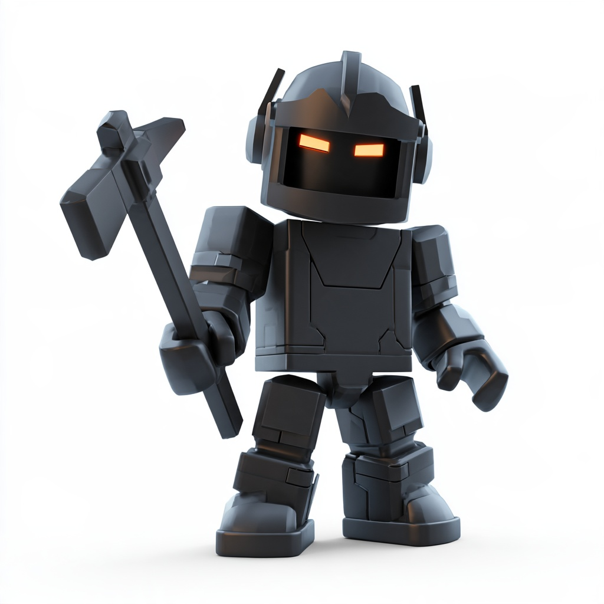

# Black Knight (`BlackKnight`)

Definition: [BlackKnight.lua](../../../../src/shared/Kits/Registry/BlackKnight.lua) · Checklist:
[KIT_MINIMUM_CHECKLIST.md](../KIT_MINIMUM_CHECKLIST.md) · Workflow: the `kit-from-prompt` skill.

- Status / gate: Design. Passes `check_kits`; no handler, no model, nothing played.
- Owner / updated: Claude, 2026-11-17.
- Role and one-sentence fantasy: **Decided.** Offense. "A walking wall that breaks the enemy line." The earlier lobby placeholder called it a defender ("Heavy Bastion"); it became the attacker so it does not repeat Neutron.
- Access type / rotation eligible: **Decided** Purchasable. **Hypothesis** rotation eligible (not answered; the default). **Pending:** Credit price.
- Fallback starter kit: Titan.
- Player decision: **Hypothesis.** When to spend the charge to break a held point.
- Passive: **Hypothesis.** Heavy Plate: knockback from the front moves you half as far. The proposed "no flinch" was dropped: the game has no flinch system to switch off.
- Tactical / Utility-slot behavior: **Hypothesis.** Breach: 0.45 s charge at 55 studs/s (about 25 studs). The first enemy hit is shoved 40 studs/s and slowed to half speed for 0.6 s. No damage. 12 s cooldown.
- Cost or vulnerable window: no firing during the charge or for 0.5 s after; a miss leaves you close and exposed.
- Enemy counterplay: sidestep and punish the recovery; shoot the side or back.
- Duplicate/stacking rule: each knight charges on its own; a slowed target is not slowed further, the slow restarts.
- Tuning source and valid ranges: the definition file.
- Keyboard / gamepad / touch action: G / DPadRight / BREACH.
- Ready / active / cooldown / failure feedback: not designed.
- Server handler and validation: `FrontalKnockbackResist`, `ForwardBash`. Neither exists. `AbilityService`'s mutation Brace (front check) and Charge (server sweep, client-applied velocity) are the code to reuse.
- Visual reference and asset handoff: **Decided** look, approved by the user on the review sheet ("Looks good", 2026-11-18): `assets/kit-looks/BlackKnight` — Midjourney concept, ten Tripo P2 pieces (helmet, chest, belt, shoulders, forearms, fists, thighs, shins, boots, cape), 19,001 triangles. **Not done:** five pieces need re-making at their exact face counts, then upload and attaching to R15 in game.
- Team-readability treatment: not designed. Dark armour with an orange visor must not read as either team; a team-colour trim is likely needed.
- Telemetry events: breach attempts, accepted, rejected by reason, hits, misses; passive triggers.
- Acceptance evidence: none.
- Known limitations / next concrete action: the model (asset workflow), then the kit runtime and the two handlers.

## Intake answers

- Look and melee, the user's words: "create the kit without the melee and then we can add the melee later as an unlock weapon." The hammer becomes a separate unlockable melee weapon, not part of this kit.
- Name, role, passive, tactical and counter: proposed by Claude, and the user went ahead without changing them.
- Price and free rotation: not answered. Price pending; rotation eligible by default.

## Not verified

Nothing has been played. Every number is a placeholder.
